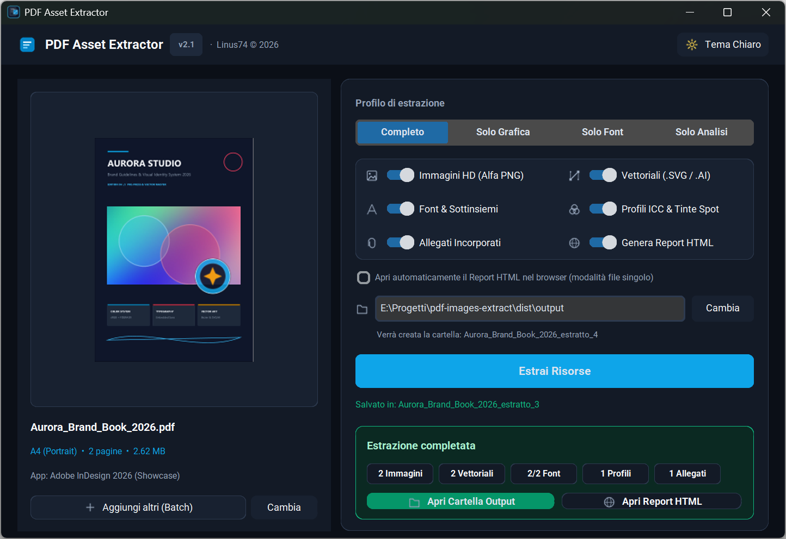
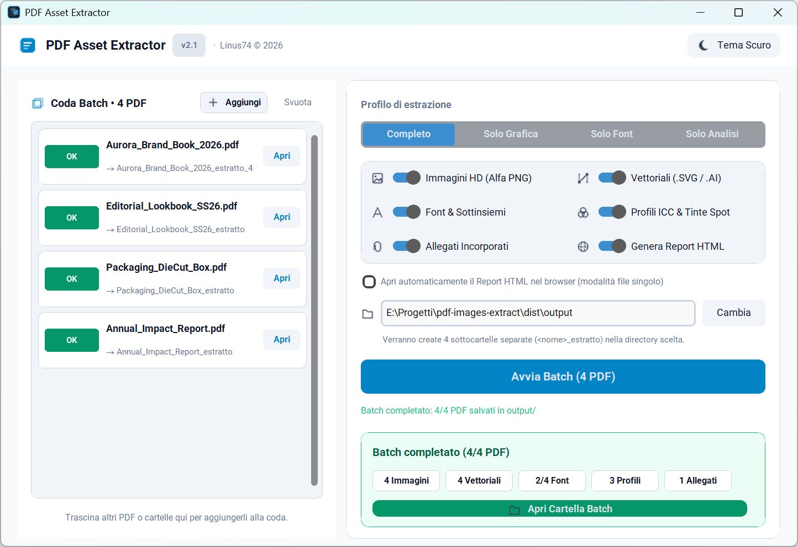
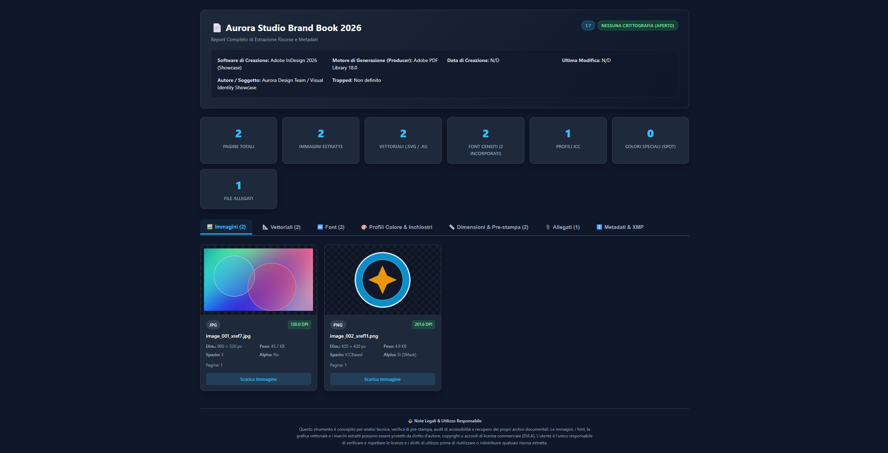

# PDF Asset & Metadata Deep Extractor

> **v2.4 · by Linus74 © 2026**
>
> A modern Desktop App, CLI tool, and Python library to inspect PDF internals and extract embedded images (with true transparency), vector artwork (`.svg` & `.ai`), fonts (with SFNT table repair), ICC color profiles, spot inks, pre-press page geometry, attachments, and full metadata.

<p align="center">
  
</p>

---

## 📸 Interface & Report Showcase

| Batch Queue (Light Mode) | Interactive Offline HTML Dashboard (`report.html`) |
| :---: | :---: |
|  |  |

---

## 🔍 What Is a PDF, Really?

Most people think of a PDF as a flat "digital printout" or a static image of a document. **In reality, a PDF (ISO 32000) is a structured object database — a digital time capsule descended from PostScript.**

Inside a single `.pdf` file, the original building blocks of the document often still exist as separate, compressed binary streams and dictionaries:

- **Raster Images (`/XObject /Image`)**: Stored in their native encodings (JPEG, Flate/PNG, JPEG2000, JBIG2). Transparency is usually stored separately in a grayscale soft mask (`/SMask`) — which is why naive extractors often turn transparent backgrounds solid black.
- **Vector Artwork**: Mathematical Bézier curves, strokes, fills, and clipping paths. Fun industry fact: since Adobe Illustrator 9, **native `.ai` files are technically PDFs under the hood** with embedded Illustrator metadata.
- **Font Programs**: Actual `.ttf`, `.otf`, `.cff`, or Type 1 font binaries embedded inside the document (either complete fonts or partial glyph subsets).
- **Color Management**: Embedded `.icc` device profiles (e.g., *sRGB*, *Coated FOGRA39*, *Display P3*) and custom spot ink definitions (`/Separation` / `/DeviceN` like *PANTONE* or *CutContour*).
- **Pre-Press Geometry**: Up to five distinct coordinate boxes per page (`MediaBox`, `CropBox`, `BleedBox`, `TrimBox`, `ArtBox`) defining physical sheet size, print bleed, and final trim dimensions.
- **Software Forensics**: Authoring application (`Creator`), PDF engine (`Producer`), PDF/A or PDF/X conformance, encryption/permission bitmasks, raw Adobe **XMP** XML packets, and embedded file attachments (`/EmbeddedFiles`).

**PDF Asset Extractor** unlocks this internal container cleanly, safely, and 100% offline.

---

## ✨ Key Features

### 🖥️ Modern Desktop App (`PDF-Extractor.exe`)
- **Horizontal Split-View UI** with **Dark & Light theme** toggle and **live `EN` / `IT` language switcher** (auto-detects OS language on first run and saves preferences).
- **Zero-Disk-Write Pre-Press Preflight**: Dedicated **`Preflight`** action (plus reopenable modal with actionable print tips) checks image DPI (`>= 300` / `< 150`), RGB vs CMYK color spaces, `BleedBox` margins, and font embedding in memory without creating output folders.
- **Instant Pre-Flight Preview**: Drag & drop a PDF to immediately inspect a rendered Page 1 thumbnail, paper format, page count, file size, authoring software, inline password prompt if encrypted, and quick `×` reset.
- **Single-File & Batch Queue**: Drop multiple PDFs or an entire folder to process them sequentially into isolated subfolders, with per-file live status and error isolation.
- **1-Click Extraction Profiles**: `Full` · `Graphics` · `Fonts` · `Audit Only` (`Completo` · `Solo Grafica` · `Solo Font` · `Solo Analisi` in IT), plus fine-grained toggles.
- **Optional HTML Dashboard**: Choose whether to generate `report.html` / `batch_report.html` and whether to auto-open it in your browser.
- **Zero-Console Windows Binary**: Compiles into a standalone `.exe` with a custom icon — no Python installation required for end users.

### 📦 What Gets Extracted

1. **Images (`images/`)**
   - Preserves native formats (JPG, PNG, JP2, etc.).
   - Reconstructs 32-bit RGBA PNG transparency by blending base images with their `/SMask` streams.
   - Deduplicates repeated assets (logos, headers) by SHA-256 hash while mapping all page occurrences.
   - Computes effective print resolution (**DPI**) from each image's placed bounding box on the page.

2. **Vector Graphics (`vectors/`)**
   - Exports clean, raster-stripped **`.svg`** files per page (compatible with Figma, Inkscape, Illustrator, browsers).
   - Exports pure-vector **`.ai`** files per page (raster images removed) that open directly in Adobe Illustrator with editable Bézier paths.
   - Counts Bézier curves, lines, rectangles, and extracts HEX color swatches.

3. **Fonts & Subsets (`fonts/`)**
   - Extracts embedded `.ttf`, `.otf`, `.cff`, `.woff`, `.pfb`/`.pfa` streams.
   - Detects subset prefixes (e.g., `ABCDEF+MyriadPro-Bold`).
   - Uses `fonttools` to validate and automatically repair missing SFNT `name` records so operating systems don't reject valid glyphs as "invalid font files".
   - Reports glyph count and available Unicode character coverage.

4. **ICC Profiles & Spot Colors (`profiles/`)**
   - Scans PDF streams for embedded ICC profiles (`acsp` signature) and saves `.icc` files.
   - Parses profile description, device class, data color space, PCS, and version.
   - Detects custom spot inks (`/Separation` and `/DeviceN`, such as Pantone swatches, `CutContour`, `Varnish`, `White`).

5. **Page Geometry & Pre-Press Boxes**
   - Extracts `MediaBox`, `CropBox`, `BleedBox`, `TrimBox`, and `ArtBox` in points (`pt`), millimeters (`mm`), and inches (`in`).
   - Identifies standard international paper sizes (A0–A8, B0–B6, Letter, Legal, Tabloid, Business Cards, Envelopes) and orientation.

6. **Metadata, Provenance & Attachments (`metadata/`, `attachments/`)**
   - Extracts `Creator`, `Producer`, ISO-normalized dates, PDF version, PDF/A / PDF/X / PDF/UA compliance, security permissions, `doc_info.json`, and raw `xmp_metadata.xml`.
   - Extracts catalog `/EmbeddedFiles` and page `/FileAttachment` annotations.

7. **Dual Reporting**
   - `report.html`: Self-contained, offline interactive visual dashboard with modal image gallery, searchable tables, color swatches, and XMP XML inspector.
   - `batch_report.html`: Unified Batch Index Dashboard generated when processing multiple PDFs, linking directly to every document's individual `report.html`.
   - `report.json`: Complete structured JSON manifest for automation and pipelines.

---

## 💡 The Truth About Embedded Fonts & Subsets

PDFs embed fonts in two ways, which this tool transparently distinguishes:

- **Full Embedded Fonts**: Contain the entire character set and can be installed and used to type any text.
- **Partial Subsets (`ABCDEF+...`)**: To reduce file size and respect foundry licensing, tools like InDesign, Illustrator, or Word strip out every character not used in that document. Even after repairing missing SFNT metadata tables for OS installability, typing characters that were absent from the original PDF will produce empty glyphs (*tofu*). Extracted subsets remain valuable for **exact font identification** and **recovering vector outlines** for existing text/logos.

---

## 📁 Safe Output Structure (Anti-Overwrite)

To ensure existing files are never overwritten (even if you pick your Desktop as destination), every processed PDF gets its own dedicated folder named `<document_name>_extracted/` (or `<document_name>_estratto/` in Italian) inside the chosen base directory (default `./output/`). Subsequent runs on the same file automatically append `_2`, `_3`, etc.:

```text
output/  (or any base folder you select)
└── sample_document_extracted/         # Automatically becomes _2, _3 if it exists
    ├── report.html                    # Interactive offline dashboard
    ├── report.json                    # Full machine-readable report
    ├── images/                        # Deduplicated images + RGBA alpha PNGs
    ├── vectors/                       # Per-page pure .svg and .ai vector files
    ├── fonts/                         # Extracted & table-repaired font binaries
    ├── profiles/                      # Extracted .icc color profiles
    ├── attachments/                   # Extracted embedded files
    └── metadata/
        ├── doc_info.json
        └── xmp_metadata.xml
```

---

## 🚀 Usage

### 1. Desktop App (Windows Standalone)
Double-click `dist\PDF-Extractor.exe` — or drag one or more PDF files (or a folder) directly onto the `.exe` icon or inside the application window.

> **🧪 Want to test right away?** The [`samples/`](samples/) folder includes 3 lightweight, copyright-free synthetic PDFs (featuring transparent RGBA images, vector shapes, Apache 2.0 Roboto fonts, sRGB ICC profile, and an embedded CSV attachment) so you can drag & drop them immediately without using your own documents.

### 2. Run from Source with `uv`
Requires **Python 3.11+** and [`uv`](https://docs.astral.sh/uv/):

```bash
# Install dependencies
uv sync

# Launch Desktop GUI
uv run pdf-extract --gui

# Extract a single PDF (outputs to ./output/<name>_extracted/ or _estratto/)
uv run pdf-extract path/to/document.pdf

# Specify output language explicitly (en or it)
uv run pdf-extract path/to/document.pdf --lang en

# Batch extract multiple PDFs or an entire folder into a custom directory
uv run pdf-extract file1.pdf file2.pdf -o ./batch_output
uv run pdf-extract ./pdf_folder/ -o ./batch_output

# Auto-open HTML dashboard after extraction
uv run pdf-extract document.pdf --open

# Run in-memory Pre-Press Preflight check only (no files written)
uv run pdf-extract document.pdf --preflight-only
uv run pdf-extract ./pdf_folder/ --preflight-only

# Password-protected PDF
uv run pdf-extract locked.pdf -p "your_password"

# Selective extraction flags
uv run pdf-extract document.pdf --no-images --no-vectors --no-fonts --no-profiles --no-attachments --no-html
```

### 3. Python API

```python
from pdf_extractor import extract_pdf_assets, extract_batch_pdfs

# Single PDF
result = extract_pdf_assets(
    pdf_path="document.pdf",
    output_dir="./output",
    generate_html=True,
)
print(result["summary"])
print(result["metadata"]["creator"], result["metadata"]["producer"])

# Batch processing
batch = extract_batch_pdfs(
    pdf_paths=["doc1.pdf", "doc2.pdf"],
    output_dir="./batch_output",
)
print(f"Processed {batch['succeeded']}/{batch['total_files']} PDFs")
```

### 4. Building the Windows `.exe`

```bash
uv run pyinstaller --noconfirm --onefile --windowed --name "PDF-Extractor" --icon "assets/app_icon.ico" --add-data "assets/app_icon.ico;assets" --paths . --collect-all customtkinter --collect-all tkinterdnd2 --collect-all pymupdf run_gui.py
```

The standalone executable will be generated at `dist\PDF-Extractor.exe`.

---

## 🧪 Running Tests

```bash
uv run pytest
```

---

## ⚖️ Legal Notice, Copyright & Responsible Use

> [!IMPORTANT]
> This tool is designed for **technical inspection, pre-press quality control, accessibility auditing, digital forensics, and recovering assets from your own archives**.
>
> - **Commercial Fonts**: Embedded fonts remain subject to the End User License Agreements (EULAs) of their respective type foundries. Extracting a font from a PDF does not grant a license to install or use it for new commercial work unless you hold a valid license.
> - **Images, Vectors & Trademarks**: Extracted artwork, photography, and logos may be protected by copyright or trademark law.
> - **User Responsibility**: You are solely responsible for ensuring you have the legal right and authorization to inspect, extract, or reuse any assets from the documents you process. The author assumes no liability for improper or unauthorized use.
